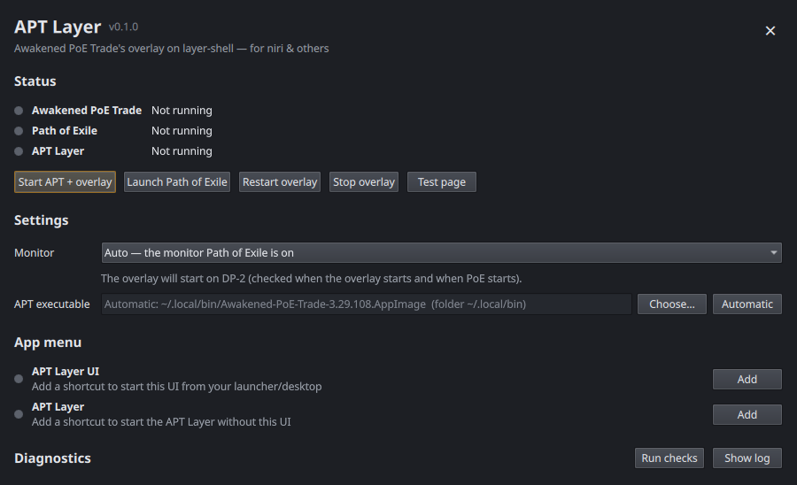

# APT with a layer-shell shim

Started as a fix for my personal setup but I've tried to make it more accommodating for other similar setups.

Status: early. Built and used on niri and currently only with Path of Exile 1.

## The Problem with APT + niri

**TL;DR:** [Awakened PoE Trade](https://github.com/SnosMe/awakened-poe-trade) (APT) on Linux normally draws its price
checks as an X11 overlay over Path of Exile. On niri that overlay can't be shown because niri runs X11 apps through xwayland-satellite, which has no support for those kinds of overlays. This project
draws APT's UI in a Quickshell layer-shell overlay instead.

## Requirements
- A Wayland compositor with layer-shell: **niri** (tested). Hyprland, Sway, KDE and others may work. Not GNOME.
- Path of Exile and APT running on **X11** (Xwayland / xwayland-satellite). **NOTE:** Don't add
  `PROTON_ENABLE_WAYLAND=1` to PoE's launch options as APT can't capture keypresses when running a Wayland native window. You should see a warning in the UI if that's the case
- **[Quickshell](https://quickshell.org)** + **Qt WebEngine**, and **python3**.
  
Not sure what you have? Just install Quickshell and run `./apt-layer-ui`: the APT Layer UI checks the rest
and tells you what's missing and how to install it.

## Getting started

1. **Get it:** `git clone https://github.com/AholaJoonas/apt-layershell` & `make dist`, or download and unpack the latest
   [release](https://github.com/AholaJoonas/apt-layershell/releases).
2. **Install [Quickshell](https://quickshell.org/docs/guide/install-setup/)** if you don't have it.
3. **Run `./apt-layer-ui`** in the folder.
4. If everything is ok - press **Start APT + overlay** and start PoE.

**APT Layer doesn't modify any PoE or Awakened PoE Trade files, so you won't break your installations by
running it.**

Nothing is installed into your system, you can keep the unpacked folder anywhere you like

## Issues & limitations

- PoE's *Windowed Fullscreen* and *Fullscreen* both work (Wayland has no
  exclusive fullscreen). In *Windowed* mode APT's panels may land next to the game instead of its inventory.
- Only tested with the game on a monitor at position 0,0 and scale 1. Other layouts may misplace clicks.
- Depends on APT's internals (tested with 3.29.108); an APT update may need an APT Layer update.
- **Currently no support for APT's built-in browser, every link opens in your normal browser instead.**
- Bit of a memory hog: about 450 MB on top of APT. APT's UI is a web page that APT normally shows in its own
  window; that window can't be an overlay on niri, so APT Layer shows the page itself, with a Chromium-based
  engine (Qt WebEngine). [Why not lighter?](docs/technical.md#memory)

## More

- [docs/technical.md](docs/technical.md) — how it works, launching, all commands, install / development.
- [docs/apt-integration.md](docs/apt-integration.md) — how APT's UI is adapted.

## License

MIT — see [LICENSE](LICENSE). Bundled python-xlib (LGPL-2.1-or-later) and six (MIT): see `lib/vendor`.
Awakened PoE Trade is a separate project you install yourself. Not affiliated with Grinding Gear Games or the
APT authors.
